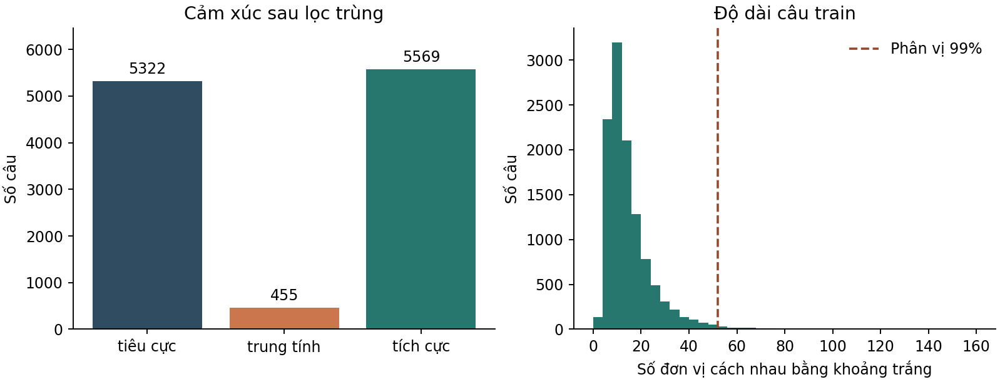

# Phân loại cảm xúc phản hồi sinh viên tiếng Việt trên UIT-VSFC

**Trường Đại học Sài Gòn** · Khoa Toán – Ứng dụng · Học sâu (DL11) · Nhóm 07

[Thống kê dữ liệu](ket_qua/EDA/theo_tap.csv) · [Tiền xử lý](src/du_lieu.py) · [Thiết kế thực nghiệm](configs/giao_thuc.json)

Đầu vào là một phản hồi của sinh viên. Đầu ra là một trong ba nhãn **tiêu cực**, **trung tính** và **tích cực**. Nhóm so sánh BiLSTM với PhoBERT để tìm hiểu ảnh hưởng của lượng dữ liệu gán nhãn, cách tách từ tiếng Việt và số tầng PhoBERT được tinh chỉnh.

> **Tiến độ công bố · 1/6 · Dữ liệu và tiền xử lý**  
> Tiếp theo, Thành bổ sung đối chứng TF-IDF và hai biến thể BiLSTM.

## Câu hỏi nghiên cứu

1. Khi giảm số câu gán nhãn, chênh lệch Macro-F1 giữa PhoBERT và BiLSTM thay đổi ra sao?
2. Tách từ ảnh hưởng đến mô hình nào nhiều hơn?
3. Mở bốn tầng cuối của PhoBERT tiết kiệm được bao nhiêu thời gian huấn luyện và ảnh hưởng thế nào đến F1 của lớp trung tính?

## Dữ liệu và tiền xử lý

Nhóm giữ cách chia tập gốc của UIT-VSFC và ưu tiên giữ câu ở test khi lọc trùng giữa các tập. Sau khi lọc 80 dòng train và 7 dòng validation, tập huấn luyện còn 11.346 câu, trong đó có 455 câu trung tính.

| Tập sau lọc | Số câu | Tiêu cực | Trung tính | Tích cực |
|---|---:|---:|---:|---:|
| Huấn luyện | 11.346 | 5.322 | 455 | 5.569 |
| Validation | 1.576 | 705 | 73 | 798 |
| Test | 3.166 | 1.409 | 167 | 1.590 |

Văn bản được chuẩn hóa Unicode và khoảng trắng, giữ dấu tiếng Việt. Trong 249 câu train gốc chứa chuỗi chữ–số, 210 câu có mã ẩn danh dạng `wzjwz` kèm chữ số. Chỉ những mã khớp mẫu trọn từ được đổi thành `mawzjwz`. Underthesea tạo thêm phiên bản tách từ để đối chiếu hai cách biểu diễn.

[Bảng thống kê theo tập](ket_qua/EDA/theo_tap.csv) · [Mã tiền xử lý](src/du_lieu.py) · [Giao thức thực nghiệm](configs/giao_thuc.json)

## Thành viên và phần phụ trách

| Thành viên | MSSV | Phần phụ trách |
|---|---|---|
| Nguyễn Trí Sự | 3123580041 | Dữ liệu, tiền xử lý, PhoBERT và tích hợp bản nộp |
| Huỳnh Nhật Thành | 3123580044 | TF-IDF, BiLSTM, fastText và thí nghiệm thay đổi lượng dữ liệu |
| Nguyễn Quốc Thuận | 3123580048 | Đánh giá, phân tích lỗi, demo, báo cáo và slide |

Dữ liệu do UIT NLP Group công bố (Nguyen và cộng sự, KSE 2018). [Bộ dữ liệu UIT-VSFC](https://huggingface.co/datasets/uitnlp/vietnamese_students_feedback/tree/2d76906157232f87e9883fa37ebfc91ffdee1f83)
